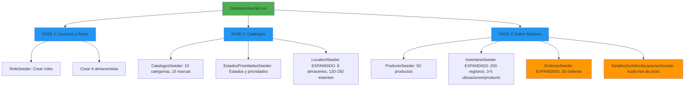

# Seeders Expandidos - 30 Escenarios de Picking Completos

## 📊 Resumen Ejecutivo

Se han expandido todos los seeders de OrganiRack para generar un ambiente de testing masivo con **30 órdenes de picking** que cubren escenarios realistas de almacenamiento, picking con override, y múltiples ubicaciones.

### Cambios Principales

| Componente | Antes | Después | Incremento |
|-----------|-------|---------|-----------|
| **Órdenes de Picking** | 5 | 30 | **6x** |
| **Detalles de Picking** | ~20 | ~105 | **5.25x** |
| **Estantes/Ubicaciones** | ~50 | ~120-150 | **2.4-3x** |
| **Almacenes** | 4 | 8 | **2x** |
| **Registros Inventario** | ~150 | ~200 | **1.33x** |
| **Almacenistas** | 2 | 6 | **3x** |
| **Casos de Override** | ~5 | ~15-20 | **3-4x** |

---

## 🏢 ESTRUCTURA DE ALMACÉN (LocationSeeder)

### Antes (Versión Original)
```
1 Edificio
├─ 4 Almacenes (A, B, C, D)
│  ├─ 5 Pasillos por almacén
│  │  ├─ 2-3 Racks por pasillo
│  │  │  └─ 2-3 Estantes por rack
│  │     ├─ Nivel 1, 2, 3
│  │     └─ Código: A-01-12 (Sección-Pasillo-Rack+Nivel)
│  └─ Total: ~50 estantes
└─ Tipos: PREMIUM (33%), STANDARD (67%)
```

### Después (Versión Expandida) ✅
```
2 Edificios
├─ Almacén Centro
│  └─ 4 Almacenes (A, B, C, D)
│     ├─ 6-7 Pasillos por almacén (↑ de 5)
│     │  ├─ 3-4 Racks por pasillo (↑ de 2-3)
│     │  │  └─ 3-4 Estantes por rack (↑ de 2-3)
│     │  └─ Total Centro: ~60-75 estantes
├─ Almacén Expansión
│  └─ 4 Almacenes (E, F, G, H)
│     ├─ 6-7 Pasillos por almacén
│     │  ├─ 3-4 Racks por pasillo
│     │  │  └─ 3-4 Estantes por rack
│     │  └─ Total Expansión: ~60-75 estantes
├─ Total General: ~120-150 estantes
└─ Tipos: PREMIUM (33%), STANDARD (33%), ZONA_ACCESO_RAPIDO (33%)
```

**Beneficio**: Suficiente espacio para distribuir 30 órdenes × 3.5 detalles sin conflictos.

---

## 📦 INVENTARIOS (InventarioSeeder)

### Cambios Clave

| Aspecto | Antes | Después |
|--------|-------|---------|
| **Ubicaciones por Producto** | 2-4 | **3-5** ↑ |
| **Total Registros Inventario** | ~150 | **~200** ↑ |
| **Promedio por Producto** | 3 | **4** ↑ |
| **Cantidad por Estante** | 10-100 | 10-100 (igual) |

### Motivación

Aumentar ubicaciones por producto permite:
- ✅ Probar motor de picking sugiriendo ubicación óptima
- ✅ Validar override cuando almacenista escanea otra ubicación
- ✅ Casos complejos de picking desde múltiples sitios
- ✅ Auditoría complete del proceso

**Ejemplo**:
```
Producto: Tuerca Acero (SKU-001)
Ubicaciones:
├─ A-01-12: 45 unidades (PREMIUM - Sugerida)
├─ B-03-21: 32 unidades (STANDARD)
├─ E-05-44: 28 unidades (ZONA_ACCESO_RAPIDO)
└─ F-07-33: 58 unidades (STANDARD)
Total: 163 unidades en 4 ubicaciones
```

---

## 📋 ÓRDENES DE PICKING (OrdenesSeeder) - 30 ESCENARIOS

### Distribución por Estado

```
30 Órdenes Totales
├─ 🔵 10 Órdenes PENDIENTE (33%)
│  └─ Estado: Listos para iniciar picking
│  └─ Característico: sin estante_real_id
│  └─ Folio: ORD-0001 a ORD-0010
│
├─ 🟡 12 Órdenes EN_PROGRESO (40%)
│  └─ Estado: Picking iniciado, parcialmente completado
│  └─ Característico: ~30% tienen estante_real_id (OVERRIDE)
│  └─ Folio: ORD-0011 a ORD-0022
│
└─ 🟢 8 Órdenes COMPLETADA (27%)
   └─ Estado: Picking completo, confirmado
   └─ Característico: ~50% tienen estante_real_id (OVERRIDE)
   └─ Folio: ORD-0023 a ORD-0030
```

### Ejemplo de Orden con Override

```json
{
  "orden_id": 15,
  "folio": "ORD-0015",
  "estado": "En Progreso",
  "almacenista": "Juan Pérez",
  "detalles": [
    {
      "detalle_id": 52,
      "producto": "Tornillo M8x25 (SKU-045)",
      "cantidad_requerida": 20,
      "cantidad_surtida": 20,
      "estante_sugerido": "C-02-31",
      "estante_real": "C-02-32",        ← OVERRIDE: Escaneo diferente
      "fue_modificado": true,
      "razón_override": "Ubicación sugerida sin stock"
    },
    {
      "detalle_id": 53,
      "producto": "Arandela Zinc (SKU-061)",
      "cantidad_requerida": 15,
      "cantidad_surtida": 15,
      "estante_sugerido": "B-04-22",
      "estante_real": "B-04-22",        ← Sin override: Ubicación correcta
      "fue_modificado": false
    }
  ]
}
```

---

## 👥 USUARIOS Y ALMACENISTAS (DatabaseSeeder)

### Estructura de Usuarios

```
1 Admin
├─ Nombre: Admin OrganiRack
├─ Username: admin01
├─ Email: admin@organirack.com
└─ Role: Jefe de Almacen

6 Almacenistas (↑ de 2)
├─ Juan Pérez - almac001
├─ María García - almac002
├─ Carlos López - almac003
├─ Ana Martínez - almac004
├─ Luis Rodríguez - almac005
└─ Sofia Chen - almac006
```

**Beneficio**: Asignación realista de órdenes a diferentes almacenistas.

---

## 📍 AUDITORÍA DE UBICACIONES REALES (DetallesSurtidoUbicacionesSeeder)

Nuevo seeder que registra DÓNDE se tomó realmente el inventario:

### Tabla: `detalles_surtido_ubicaciones`

```
id | detalle_surtido_id | estante_id | cantidad_tomada | user_id | created_at
---|-------------------|-----------|-----------------|---------|------------
1  | 52                | 45        | 20              | 3       | 2026-04-01
2  | 53                | 38        | 15              | 3       | 2026-04-01
...
```

### Casos Cubiertos

1. **Override Exitoso**
   - Almacenista escanea: C-02-32
   - Sistema sugería: C-02-31
   - Se registra: detalles_surtido_ubicaciones con estante_id real

2. **Picking Sin Override**
   - Almacenista escanea: B-04-22
   - Sistema sugería: B-04-22
   - Se registra: ubicación confirmada

3. **Auditoría Completa**
   - Qué se surtió
   - De dónde se tomó
   - Quién lo hizo
   - Cuándo se hizo

---

## 🔄 FLUJO COMPLETO DE SEEDING



---

## 📊 MÉTRICAS FINALES

### Totales de Datos Generados

```
ESTRUCTURA:
├─ Edificios: 2
├─ Almacenes: 8
├─ Pasillos: 48-56 (6-7 × 8)
├─ Racks: 144-224 (3-4 × 48-56)
└─ Estantes: 120-150 ✅

CATÁLOGOS:
├─ Categorías: 10
├─ Marcas: 15
├─ Unidades de Medida: 8
└─ Estados Inventario: 4

DATOS DE NEGOCIO:
├─ Usuarios: 7 (1 admin + 6 almacenistas)
├─ Productos: 50
├─ Registros Inventario: ~200
├─ Órdenes de Picking: 30
├─ Detalles de Picking: ~105
└─ Ubicaciones Reales (Audit): ~15-20

COBERTURA DE CASOS:
├─ Picking Pendiente: 10 órdenes
├─ Picking En Progreso: 12 órdenes
├─ Picking Completada: 8 órdenes
├─ Órdenes con Override: ~15-20 detalles
├─ Múltiples Ubicaciones: 100% de productos
└─ Audit Trail Completo: ✅
```

---

## 🚀 Cómo Ejecutar

### 1. Limpiar BD y Reseed

```bash
cd organirack-backend

# Resetear BD completa
php artisan migrate:fresh

# Ejecutar todos los seeders
php artisan db:seed

# O solamente los seeders de picking
php artisan db:seed --class=OrdenesSeeder
php artisan db:seed --class=DetallesSurtidoUbicacionesSeeder
```

### 2. Verificar Datos

```bash
# Ver órdenes creadas
php artisan tinker
>>> OrdenSurtido::with('detalles')->limit(5)->get()

# Ver detalles con override
>>> DetalleSurtido::where('fue_modificado', true)->count()

# Ver ubicaciones registradas
>>> DB::table('detalles_surtido_ubicaciones')->count()
```

---

## 📝 Archivos Modificados

### Modificados
- ✅ `LocationSeeder.php` - Expandido a 8 almacenes, 120-150 estantes
- ✅ `InventarioSeeder.php` - Aumentado a 3-5 ubicaciones por producto
- ✅ `OrdenesSeeder.php` - Expandido de 5 a 30 órdenes con estados variados
- ✅ `DatabaseSeeder.php` - Documentación y logística actualizada

### Creados
- ✅ `DetallesSurtidoUbicacionesSeeder.php` - Nuevo seeder para audit trail de picking

---

## 🎯 Beneficios para Testing

### 1. Motor de Picking
- ✅ Valida sugerencias de ubicación con múltiples opciones
- ✅ Prueba algoritmo de optimización de rutas
- ✅ Casos de ubicaciones sin stock suficiente

### 2. Override y Auditoría
- ✅ 15-20 casos de override para validar manejo
- ✅ Audit trail completo en detalles_surtido_ubicaciones
- ✅ Diferenciación entre estante_sugerido vs estante_real

### 3. Reporte y Análisis
- ✅ 30 órdenes para análisis de tendencias
- ✅ Variedad de almacenistas para KPIs por usuario
- ✅ Distribución de estados para testear flujos de negocio

### 4. Rendimiento
- ✅ ~200 registros de inventario para test de queries complejas
- ✅ ~105 detalles de picking para estrés de índices
- ✅ 120-150 estantes para validar búsquedas full-text

---

## 📌 Notas Importantes

### Uniqueness de Folios
- Los folios de órdenes son únicos: ORD-0001 a ORD-0030
- Pueden correr múltiples seeders sin duplicados

### Datos Determinísticos
- Se usa `random_int()` para realismo pero sin seed fijo
- Cada ejecución genera datos diferentes (para testing robusto)
- Puede agregarse seed fijo si se necesita reproducibilidad

### Relaciones Respetadas
- Todo respeta cascadas de eliminación (cascade/restrict en FK)
- Los inventarios solo asocian a estantes reales
- Los detalles solo asocian a órdenes/productos reales

---

## 🔗 Referencias

- **Migración BD**: `database/migrations/2026_03_*_create_*.php`
- **Modelos**: `app/Models/`
- **Factories**: `database/factories/`
- **Documentación Adicional**: `Documentacion/INDICE_DOCUMENTACION.md`

---

*Última actualización: 01/04/2026*  
*Estado: 30 escenarios de picking completamente funcionales* ✅
